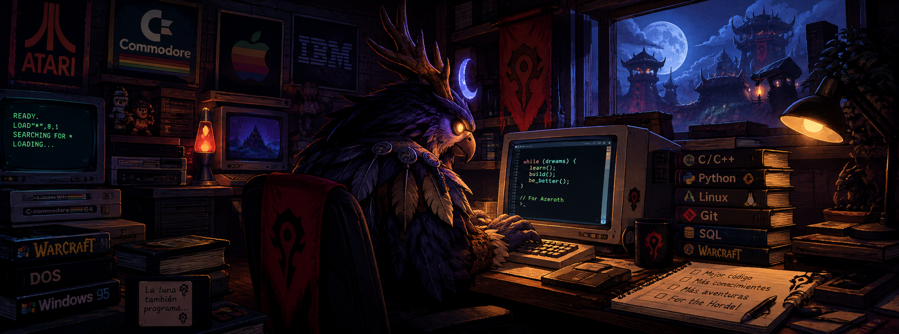
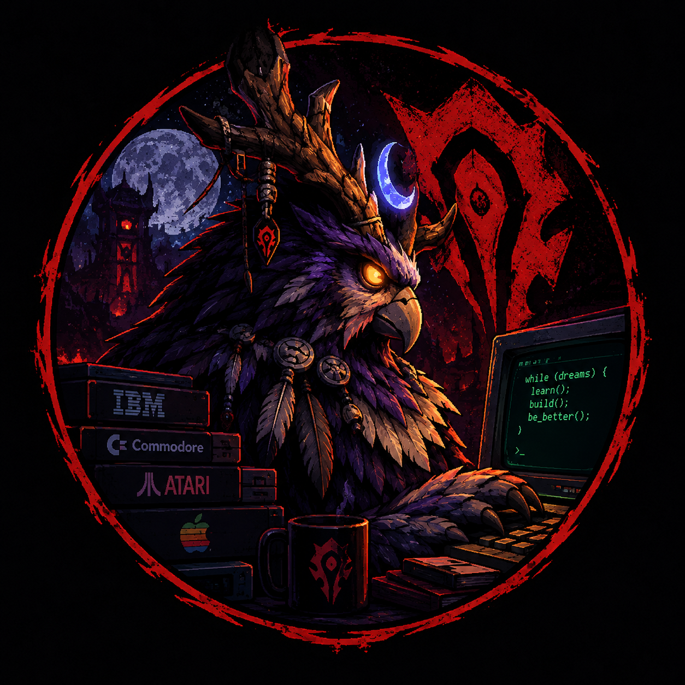

  

# ⚡ Rafael Morantes (RafxDev) ⚡
### 🌙 *Code Druid* | 🏹 *Horde Developer* | 💻 *Web & Software Craftsman*

  <em>"while (dreams) { learn(); build(); be_better(); } // For the Horde! ⚔️"</em>

 

## 📜 Character Sheet

I am a **Software Development Technician with an emphasis on Web Applications**, passionate about building software solutions, architecture, and continuous learning. Avid fan of the **World of Warcraft** universe, algorithmic music, and technology designed to solve real-world challenges.

* 🛡️ **Primary Class:** Tech Druid (Web Development, Automation & Software Tools).
* ⚔️ **Faction:** Horde (Lok'tar Ogar!).
* 🧠 **Passive Skills:** Debugging Resilience, Rapid Learning, and Logical-Mathematical Mindset.
* 🎧 **Sonic Hobby:** Live Coding with **Strudel**, crafting beats and algorithmic rhythms live (heavily inspired by DJ_DAVE).
* 🎮 **Azeroth Pastime:** Adventurer in World of Warcraft.

 
 

---

## 🗺️ Active Quest Log

Current quests and expeditions I am embarking on across the software realm:

- 🌍 **`[Main Quest]` Environmental Guardian — Carbon Footprint Measurement Platform:**
  Actively collaborating on the development of a technological platform for calculating, monitoring, and analyzing environmental impact and carbon emissions.

- ⚖️ **`[Forge Quest]` Hardware Interface — Smart Scale Data Reader:**
  Engineered an automation tool that reads real-time weight data from industrial/commercial scales and enables instant one-key copying to the clipboard (optimizing operational workflows).

- 📐 **`[Wisdom Quest]` Archives of Dalaran — Education & Applied Mathematics:**
  Creating and curating open-source learning repositories to teach **programming languages** and leading a specialized project focused on **mathematics for developers**.

- 🎓 **`[Community Quest]` Guild Mentor:**
  Mentoring and guiding tech enthusiasts to support their journey and growth in the developer ecosystem.

---

## 🔮 Talent Tree & Spellbook (Tech Stack)

  

<b>📖 Spellbook Skill Breakdown</b>

 

| Magic School | Skills & Technologies |
| :--- | :--- |
| **🌐 Frontend & Interfaces** | HTML5, CSS3, JavaScript, Web UI/UX |
| **⚙️ Backend & Languages** | Python, Java, Bash Scripting |
| **💾 Data & Persistence** | MySQL, Firebase, Data Analytics Fundamentals |
| **☁️ Cloud & Environments** | AWS, Azure, Google Cloud Platform (GCP), Linux |
| **🛠️ Forge Tools** | Git, GitHub Actions, VS Code, Discord.js, Notion |

---

## 🏆 Unlocked Achievements

* 🥇 **[Legendary Achievement] Data Analytics Fundamentals:** Certified by **DS4A / Colombia** and **Correlation One**.
* 🎖️ **[Epic Achievement] Mastery Paths:** Specialized diploma and course certifications in **Java** and **Python**.
* 🏅 **[Guild Achievement] Tech Alliances:** Programs completed with **Oracle Academy**, **Hewlett Packard Enterprise**, **IBM SkillsBuild**, and **Alura Latam**.

---

## ⚔️ Battle Records (GitHub Stats)

  

  <table>
    <tr>
      <td>
        
      </td>
      <td>
        
      </td>
      <td>
        
      </td>
    </tr>
  </table>
   
  

 

### 🐍 The Contribution Wyrm

  

---

## 📍 Hearthstone (Contact)

Looking to team up for a quest, talk software engineering, or discuss World of Warcraft? Feel free to reach out!

  
  
  
  

  🛡️ <i>Lok'tar Ogar! May your scripts never fail and your builds be legendary.</i> 🛡️

