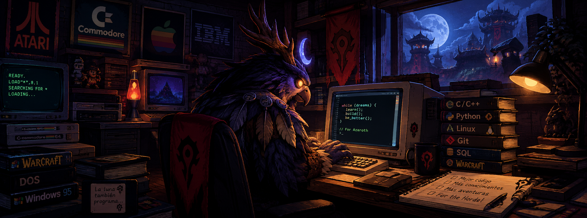
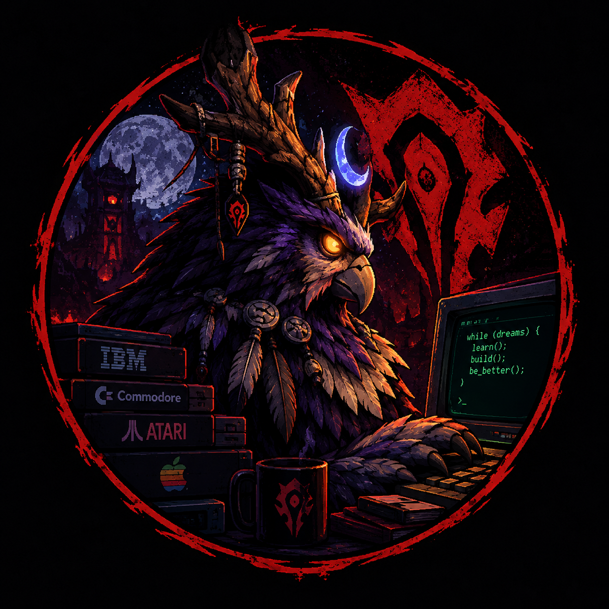

  

# ⚡ Rafael Morantes (RafxDev) ⚡
### ❄️ *Ex-Blizzard Game Dev (2 Yrs)* | 🏢 *Ex-IBM Engineer & Trainer* | 📦 *Ex-Amazon Intern* | 🕹️ *Indie Horror Game Dev*

  

  
  
  
  
  
  
  

  <em>"while (true) { learn(); build(); be_better(); } 🚀"</em>

 

<!-- ========================================== -->
<!-- 🇪🇸 VERSIÓN EN ESPAÑOL (ABIERTA POR DEFECTO)-->
<!-- ========================================== -->

  
🇪🇸 <b>Versión en Español</b> <i>(Click para plegar / colapsar)</i>

   

  ## 👤 Perfil Profesional

  

  **Rumano de nacimiento 🇷🇴 y actualmente radicado en Colombia 🇨🇴.** Desarrollador de Software y Programador de Videojuegos con trayectoria en reconocidas compañías globales de tecnología y entretenimiento: **Ex-Pasante de Desarrollo de Videojuegos por 2 años en Blizzard Entertainment**, **Ex-Ingeniero de Software y Capacitador Técnico en IBM**, y **Ex-Practicante en Amazon**.

  Apasionado por la arquitectura limpia, los sistemas interactivos, la automatización y el desarrollo de experiencias inmersivas. Actualmente enfocado en ingeniería de software y en el **desarrollo activo de un videojuego indie de terror psicológico**.

  * 🌍 **Origen & Ubicación:** Rumano de nacimiento 🇷🇴, viviendo actualmente en Colombia 🇨🇴.
  * ❄️ **Trayectoria Blizzard Entertainment:** 2 años como pasante en desarrollo de videojuegos, colaborando en mecánicas de gameplay, optimización y procesos de producción en la industria AAA.
  * 🏢 **Trayectoria IBM:** Ex-Ingeniero de Software y Capacitador/Entrenador Técnico corporativo en tecnologías clave, buenas prácticas y formación de talento.
  * 📦 **Trayectoria Amazon:** Ex-Practicante de ingeniería de software, familiarizado con desarrollo ágil y arquitecturas escalables.
  * 🕹️ **Indie Game Development:** Desarrollador independiente; creando un título de terror y misterio psicológico (*¡pronto más información y avances oficiales!*).
  * 🗣️ **Idiomas:**
    - 🇷🇴 **Rumano:** Nativo (Limba maternă).
    - 🇪🇸 **Español:** Nativo.
    - 🇨🇳 **Chino Mandarín:** 100% (Fluidez completa / Bilingüe).
    - 🇺🇸 **Inglés:** Intermedio (Competencia técnica y profesional).
  * 💼 **Especialidad Técnica:** Game Development, Desarrollo Web Full Stack, automatización y herramientas de software.
  * 🧠 **Habilidades Diferenciales:** Gameplay programming, pensamiento lógico-matemático, pedagogía técnica y resolución de problemas complejos.
  * 🎧 **Intereses Creativos:** Live Coding algorítmico con **Strudel** (música por código inspirada en DJ_DAVE), desarrollo retro/homebrew (Nintendo DS & Commodore 64) y narrativa interactiva.

   
   

  ---

  ## 💼 Trayectoria & Experiencia Destacada

  ### ❄️ Blizzard Entertainment — Desarrollador de Videojuegos (Pasante / 2 Años)
  * **Game Development & Gameplay:** 2 años inmerso en el desarrollo de videojuegos, colaborando en la implementación de mecánicas de juego, depuración de sistemas y optimización de rendimiento.
  * **Pipelines de Producción AAA:** Experiencia práctica con estándares rigurosos de la industria del videojuego, flujos de integración, herramientas internas y trabajo en equipos multidisciplinarios.

  ### 🏢 IBM — Ex-Ingeniero de Software & Capacitador / Entrenador Técnico
  * **Ingeniería de Software:** Diseño, desarrollo, testing y optimización de soluciones de software escalables bajo altos estándares corporativos y arquitecturas robustas.
  * **Capacitación y Formación Corporativa:** Liderazgo en capacitación técnica y transferencia de conocimiento. Diseño e impartición de entrenamientos especializados en desarrollo de software, metodologías de ingeniería y adopción de tecnologías.

  ### 📦 Amazon — Ex-Practicante de Desarrollo de Software (Intern)
  * **Ingeniería y Cloud:** Experiencia práctica en desarrollo y soporte de componentes de software dentro del ecosistema tecnológico de Amazon, aplicando estándares de alta fiabilidad y resolución metódica de problemas.

  ---

  ## 🚀 Proyectos e Iniciativas

  > ### 🕯️ `[Game Dev Spotlight]` Videojuego de Terror Psicológico — *En Desarrollo Activo*
  > * **Motor & Tecnologías:** Godot Engine | **Género:** Terror Psicológico / Misterio / Suspenso
  > * **Propuesta:** Una experiencia inmersiva centrada en atmósfera opresiva, diseño de sonido diegético envolvente, mecánicas de investigación y una narrativa que desafía la percepción del jugador.
  > * 📢 **Estado:** *En producción activa. ¡Pronto revelaremos más información, detalles del universo y avances oficiales!*

   

  #### 📌 Otros Proyectos Clave & Líneas de Desarrollo:

  - 🏪 **`[Sistemas Comerciales & POS]` Sistema de Punto de Venta (POS) para Negocios:**  
    Desarrollo, mejora continua y optimización integral de una plataforma POS comercial. Actualmente en producción activa con comercios reales que gestionan sus ventas diarias, inventarios, caja y facturación con alta fiabilidad.

  - 🎵 **`[Retro Dev]` Reproductor MP3 Vintage — Windows & Nintendo DS:**  
    Desarrollo de un reproductor de audio retro con estética vintage para Windows y portado a Nintendo DS, explorando desarrollo homebrew y optimización para arquitecturas portátiles clásicas.

  - 🕹️ **`[Emulación & Low-Level]` Arquitectura de 8-Bits — Emulador de Commodore 64:**  
    Investigación de hardware de computación clásica y construcción de un emulador para el legendario Commodore 64, profundizando en registros, ciclo de instrucciones y prototipado experimental.

  - 🌍 **`[Sostenibilidad]` Plataforma de Medición de Huella de Carbono:**  
    Desarrollo y colaboración técnica en una plataforma para el cálculo, seguimiento e interpretación de datos sobre impacto ambiental y emisiones de carbono.

  - ⚖️ **`[Hardware & Automatización]` Lector de Datos para Balanzas Industriales:**  
    Herramienta de automatización que se conecta a balanzas industriales y comerciales, captura pesos en tiempo real y los envía o copia con un solo atajo de teclado, optimizando flujos operativos.

  - 📐 **`[Educación & Open Source]` Divulgación y Matemáticas Aplicadas:**  
    Creación y curaduría de repositorios educativos abiertos sobre **fundamentos de programación** y un proyecto enfocado en **matemáticas para desarrolladores de software**.

  - 🎓 **`[Comunidad & Mentoría]` Acompañamiento y Capacitación:**  
    Orientación continua y mentoría técnica a desarrolladores emergentes, promoviendo el pensamiento crítico, la depuración metódica y el crecimiento profesional.

  ---

  ## 🛠️ Stack Tecnológico (Tech Stack)

  

    
  

  | Categoría | Tecnologías y Herramientas |
  | :--- | :--- |
  | **🎮 Game Development** | Godot Engine, GDScript, Gameplay Programming, Game Design, Diseño de Audio & Atmósfera |
  | **🌐 Frontend e Interfaces** | Next.js, HTML5, CSS3, JavaScript, Web UI/UX, Responsive Design |
  | **⚙️ Backend y Lenguajes** | Python, Java, Bash Scripting, Node.js / JavaScript |
  | **💾 Datos y Persistencia** | MySQL, Firebase, Fundamentos de Análisis de Datos & SQL |
  | **☁️ Nube y Entornos** | AWS, Azure, Google Cloud Platform (GCP), Linux / Servidores |
  | **🛠️ DevOps y Flujo de Trabajo** | Git, GitHub Actions, CI/CD, VS Code, Discord.js, Notion |

  ---

  ## 🏆 Certificaciones y Reconocimientos

  * ❄️ **Blizzard Entertainment:** Experiencia acumulada de 2 años en desarrollo de videojuegos y dinámicas de producción.
  * 🏢 **IBM:** Trayectoria profesional como Ingeniero de Software y Capacitador Técnico, complementada con programas de especialización técnica e **IBM SkillsBuild**.
  * 📦 **Amazon:** Experiencia de formación técnica y desarrollo de software como practicante (intern).
  * 🥇 **Fundamentos de Análisis de Datos:** Certificado por **DS4A / Colombia** y **Correlation One**.
  * 🎖️ **Desarrollo de Software & Especialización:** Diplomados y formaciones avanzadas en **Java** y **Python**.
  * 🏅 **Alianzas Académicas Internacionales:** Culminación de programas con **Oracle Academy**, **Hewlett Packard Enterprise (HPE)** y **Alura Latam**.

 

<!-- ========================================== -->
<!-- 🇺🇸 ENGLISH VERSION (COLLAPSED BY DEFAULT)  -->
<!-- ========================================== -->

  
🇺🇸 <b>English Version</b> <i>(Click to expand / Click para desplegar)</i>

   

  ## 👤 Professional Profile

  

  **Born in Romania 🇷🇴 and currently based in Colombia 🇨🇴.** Software & Game Developer with corporate experience across leading tech and entertainment companies: **2-Year Game Developer Intern @ Blizzard Entertainment**, **Ex-Software Engineer & Corporate Technical Trainer @ IBM**, and **Former SDE Intern @ Amazon**.

  Passionate about clean architecture, interactive systems, automation, and crafting immersive gaming experiences. Currently focused on software tooling and the **active development of an indie psychological horror game**.

  * 🌍 **Origin & Location:** Born in Romania 🇷🇴, currently living in Colombia 🇨🇴.
  * ❄️ **Blizzard Entertainment Experience:** 2 years as a game developer intern, working on gameplay programming, mechanics, and game systems optimization in an AAA production environment.
  * 🏢 **IBM Experience:** Ex-Software Engineer & Corporate Technical Trainer at **IBM**, driving software quality and mentoring engineering teams.
  * 📦 **Amazon Experience:** Former SDE intern, gaining hands-on software development experience within Amazon's fast-paced cloud ecosystem.
  * 🕹️ **Indie Game Development:** Indie game creator; currently developing an atmospheric psychological horror game (*more details & announcements coming soon!*).
  * 🗣️ **Languages:**
    - 🇷🇴 **Romanian:** Native.
    - 🇪🇸 **Spanish:** Native.
    - 🇨🇳 **Mandarin Chinese:** 100% (Full Fluency / Native-level).
    - 🇺🇸 **English:** Intermediate (Technical & professional proficiency).
  * 💼 **Core Focus:** Game Development, Full Stack Web Development, software tooling, and system automation.
  * 🧠 **Key Strengths:** Gameplay programming, analytical problem solving, technical pedagogy, and logical-mathematical mindset.
  * 🎧 **Creative Passions:** Algorithmic live coding with **Strudel** (generative beats & rhythmic code inspired by DJ_DAVE), retro homebrew development (Nintendo DS & Commodore 64), and game design.

   
   

  ---

  ## 💼 Career & Experience Highlights

  ### ❄️ Blizzard Entertainment — Game Developer (Intern / 2 Years)
  * **Game Development & Gameplay:** 2 years actively programming gameplay mechanics, debugging complex systems, and optimizing runtime performance.
  * **AAA Production Pipelines:** Hands-on experience with game industry engineering standards, internal tooling, large-scale version control, and cross-functional team dynamics.

  ### 🏢 IBM — Ex-Software Engineer & Corporate Technical Trainer
  * **Software Engineering:** Designed, implemented, and optimized scalable software components adhering to enterprise standards and clean code principles.
  * **Technical Training & Mentorship:** Directed and facilitated technical training sessions for engineering talent, accelerating developer onboarding and elevating skills in core technologies and engineering workflows.

  ### 📦 Amazon — Former Software Development Engineer Intern (SDE Intern)
  * **Engineering & Cloud Ecosystem:** Contributed to software components within Amazon's technology stack, focusing on high operational standards, cloud services, and structured problem solving.

  ---

  ## 🚀 Current Projects & Initiatives

  > ### 🕯️ `[Game Dev Spotlight]` Psychological Horror Indie Game — *Active Development*
  > * **Engine & Tools:** Godot Engine | **Genre:** Psychological Horror / Mystery / Suspense
  > * **Concept:** An unsettling atmospheric experience emphasizing diegetic soundscapes, environmental storytelling, puzzle investigation, and psychological tension.
  > * 📢 **Status:** *Currently in active production. Official game details, universe reveal, and devlogs coming soon!*

   

  #### 📌 Other Active Projects & Focus Areas:

  - 🏪 **`[Commercial Systems & POS]` Point of Sale (POS) Business System:**  
    End-to-end development and continuous enhancement of a comprehensive retail POS solution. Actively deployed in production, empowering real businesses with inventory, billing, sales, and checkout workflows.

  - 🎵 **`[Retro Dev]` Vintage MP3 Player — Windows & Nintendo DS:**  
    Crafting a retro-styled music player for Windows and ported to Nintendo DS homebrew, exploring low-resource optimization on classic portable hardware.

  - 🕹️ **`[Emulation & Low-Level]` 8-Bit Architecture — Commodore 64 Emulator:**  
    Investigating vintage computing architectures and building a Commodore 64 emulator to study machine cycles, memory mapping, and instruction sets.

  - 🌍 **`[Sustainability]` Carbon Footprint Measurement Platform:**  
    Collaborating on the technical development of a data-driven platform that quantifies, tracks, and analyzes environmental impact and carbon emissions.

  - ⚖️ **`[Hardware & Automation]` Industrial Scale Data Automation Tool:**  
    Engineered an automated utility connecting industrial and commercial scales to read real-time weights and copy them instantly via hotkey, eliminating manual input mistakes.

  - 📐 **`[Education & Open Source]` Applied Mathematics & Dev Guides:**  
    Curating open-source educational repositories on **programming fundamentals** and authoring a practical guide on **applied mathematics for software engineers**.

  - 🎓 **`[Community & Mentorship]` Technical Guidance:**  
    Mentoring emerging developers, fostering algorithmic thinking, debugging perseverance, and software engineering career growth.

  ---

  ## 🛠️ Tech Stack

  

    
  

  | Category | Technologies & Tools |
  | :--- | :--- |
  | **🎮 Game Development** | Godot Engine, GDScript, Gameplay Programming, Game Design, Audio Atmosphere Direction |
  | **🌐 Frontend & Interfaces** | Next.js, HTML5, CSS3, JavaScript, Web UI/UX, Responsive Design |
  | **⚙️ Backend & Languages** | Python, Java, Bash Scripting, Node.js / JavaScript |
  | **💾 Data & Persistence** | MySQL, Firebase, Data Analytics Fundamentals & SQL |
  | **☁️ Cloud & Environments** | AWS, Azure, Google Cloud Platform (GCP), Linux Systems |
  | **🛠️ DevOps & Workflow** | Git, GitHub Actions, CI/CD, VS Code, Discord.js, Notion |

  ---

  ## 🏆 Certifications & Achievements

  * ❄️ **Blizzard Entertainment:** 2 years of professional game development experience and production collaboration.
  * 🏢 **IBM:** Professional background as Software Engineer and Corporate Technical Trainer, backed by specialized training and **IBM SkillsBuild**.
  * 📦 **Amazon:** Technical internship experience within Amazon's engineering ecosystem.
  * 🥇 **Data Analytics Fundamentals:** Certified by **DS4A / Colombia** and **Correlation One**.
  * 🎖️ **Software Development Specialization:** Advanced diplomas and certifications in **Java** and **Python**.
  * 🏅 **International Academic Alliances:** Completed programs with **Oracle Academy**, **Hewlett Packard Enterprise (HPE)**, and **Alura Latam**.

 

<!-- ========================================== -->
<!-- 🇨🇳 CHINESE VERSION (COLLAPSED BY DEFAULT)  -->
<!-- ========================================== -->

  
🇨🇳 <b>中文版本 (Chinese Version)</b> <i>(点击展开 / Click para desplegar)</i>

   

  ## 👤 个人简介 (Profile)

  

  **出生于罗马尼亚 🇷🇴，现定居生活于哥伦比亚 🇨🇴。** 我是一名兼具全球顶尖游戏研发与跨国科技企业经历的软件及游戏开发者。曾拥有 **暴雪娱乐 (Blizzard Entertainment) 2年游戏开发实习经历**、**IBM 前软件工程师与企业技术培训讲师 (Ex-Software Engineer & Corporate Trainer @ IBM)** 以及 **亚马逊 (Amazon) 前软件开发实习生** 的多元背景。

  热衷于整洁软件架构（Clean Architecture）、交互系统、工作流自动化及高沉浸度数字体验。目前在推进专业开发工具研发的同时，以独立游戏开发者身份，正全心投入制作一款**心理恐怖独立游戏**。

  * 🌍 **出生地与居住地：** 罗马尼亚原籍 🇷🇴，目前定居生活于哥伦比亚 🇨🇴。
  * ❄️ **暴雪娱乐 (Blizzard Entertainment)：** 2年游戏开发实习生经历，专注于游戏玩法与系统逻辑开发、性能优化及大型游戏工业化管线协作。
  * 🏢 **IBM：** 前软件工程师与企业培训导师，深耕企业级系统架构研发，并主持面向技术团队的高阶技术培训与人才赋能。
  * 📦 **亚马逊 (Amazon)：** 前软件开发实习生，深入理解高可用云生态与严谨的工业级工程文化。
  * 🕹️ **独立游戏开发：** 独立游戏开发者；正在积极制作一款注重心理压迫与氛围沉浸的恐怖游戏（*即将发布更多最新动态*）。
  * 🗣️ **语言能力 (Languages)：**
    - 🇷🇴 **罗马尼亚语 (Romanian)：** 母语 (Native)。
    - 🇪🇸 **西班牙语 (Spanish)：** 母语 (Native)。
    - 🇨🇳 **中文普通话 (Mandarin)：** 100% 完全精通 / 母语级流利（Full Native-level Fluency）。
    - 🇺🇸 **英语 (English)：** 中级 (Intermediate / 具备专业技术沟通与阅读能力)。
  * 💼 **技术主攻：** 游戏研发 (Game Dev)、全栈 Web 开发、工作流自动化与高效率开发工具链。
  * 🧠 **核心能力：** 游戏架构与底层逻辑设计、逻辑与数学思维、跨文化技术教学与沟通、敏捷工程实现。
  * 🎧 **创作探索：** 使用 **Strudel** 编写实时生成代码音乐（Live Coding Algorave，受 DJ_DAVE 启发）、复古掌机与硬件开发（任天堂 NDS 自制软件、Commodore 64）以及游戏叙事设计。

   
   

  ---

  ## 💼 职业经历亮点 (Career Highlights)

  ### ❄️ 暴雪娱乐 (Blizzard Entertainment) — 游戏开发者 (实习生 / 2年)
  * **游戏研发与玩法实现：** 2年深度参与游戏系统逻辑编写、核心交互机制实现、Bug 排查及游戏运行性能调优。
  * **AAA 工业化流程协作：** 深入体验全球顶尖游戏研发工业化体系，熟练运用内部研发工具与大规模代码版本协同。

  ### 🏢 IBM — 前软件工程师与企业技术培训导师 / 讲师 (Ex-Software Engineer & Corporate Trainer)
  * **企业级软件研发：** 遵循高标准工程规范，主导并参与高可用模块设计与系统架构优化。
  * **技术导师与企业培训：** 担任技术讲师，主讲核心编程技术、工程实践及技术栈赋能课程。

  ### 📦 亚马逊 (Amazon) — 前软件开发实习生 (SDE Intern)
  * **云端与工程实操：** 参与亚马逊技术生态下的软件开发与系统支持，掌握高可用与分布式系统的工程设计理念。

  ---

  ## 🚀 进行中的重点项目 (Featured & Active Projects)

  > ### 🕯️ `[游戏焦点]` 心理恐怖独立游戏 (Psychological Horror Game) — *积极研发中*
  > * **游戏引擎：** Godot Engine | **游戏类型：** 心理恐怖 / 探索悬疑 / 沉浸叙事
  > * **设计理念：** 专注压抑沉浸的场景氛围、环境拟真音效系统、调查谜题机制，以及对玩家心理的递进式悬疑叙事。
  > * 📢 **当前状态：** *正在紧锣密鼓开发中。官方游戏名称、概念预告及开发日志即将正式揭晓，敬请期待！*

   

  #### 📌 其他代表性项目与研发方向：

  - 🏪 **`[商业系统 & POS]` 商业收银与门店管理 POS 系统：**  
    全流程参与设计、持续重构与优化的商业级 POS 系统。目前已在真实商户环境中稳定投入商用，日常支撑销售开单、收银对账与库存管理。

  - 🎵 **`[复古开发]` 经典复古 MP3 播放器 — Windows & 任天堂 DS：**  
    设计具有复古质感的音频播放程序，并成功移植至任天堂 DS（NDS Homebrew），深入挖掘经典移动掌机架构与底层硬件限制下的优化策略。

  - 🕹️ **`[模拟器与底层]` 8位元计算架构 — Commodore 64 模拟器：**  
    深入研读经典计算机底层硬件规范与指令集周期，自主编写 Commodore 64 模拟器，探索芯片时钟与内存映射机制。

  - 🌍 **`[可持续发展]` 碳足迹计算与环境数据分析平台：**  
    协作研发基于数据驱动的环境测算平台，实现温室气体排放监测、数据建模及环境影响量化评估。

  - ⚖️ **`[硬件与自动化]` 工业智能电子秤实时数据采集器：**  
    打通商业/工业电子秤硬件接口，实现重量数据毫秒级读取与一键全局复制，大幅消除人工输入错误，提升仓储物流效率。

  - 📐 **`[开源教育]` 开发者数学与编程语言系列指南：**  
    编写并维护面向开发者的开源基础教程，发起专为**程序员设计的应用数学基础**知识库与学习路径。

  - 🎓 **`[社区建设]` 开发者辅导与成长赋能：**  
    定期为技术初学者提供技术答疑与导师辅导，帮助新手建立系统化工程思维与代码排错习惯。

  ---

  ## 🛠️ 技术栈 (Tech Stack)

  

    
  

  | 类别 | 技能与核心工具 |
  | :--- | :--- |
  | **🎮 游戏开发** | Godot Engine, GDScript, 游戏玩法编程, 游戏系统设计, 氛围音效导演 |
  | **🌐 前端与界面** | Next.js, HTML5, CSS3, JavaScript, Web UI/UX, 响应式布局 |
  | **⚙️ 后端与语言** | Python, Java, Bash 脚本, Node.js / JavaScript |
  | **💾 数据与存储** | MySQL, Firebase, 数据分析基础与 SQL |
  | **☁️ 云计算与运维** | AWS, Azure, Google Cloud Platform (GCP), Linux 系统与服务 |
  | **🛠️ 工具与工作流** | Git, GitHub Actions (CI/CD), VS Code, Discord.js, Notion |

  ---

  ## 🏆 资质认证与荣誉 (Certifications & Achievements)

  * ❄️ **暴雪娱乐 (Blizzard Entertainment)：** 2年游戏工业化一线研发与团队协作实战经验。
  * 🏢 **IBM：** 具备 IBM 软件工程师与技术培训讲师任职实绩，拥有 **IBM SkillsBuild** 及多项专项技术认证。
  * 📦 **亚马逊 (Amazon)：** 具备亚马逊体系下的软件工程实习实战经历。
  * 🥇 **数据分析专项：** 由 **DS4A / Colombia** 与 **Correlation One** 联合认证。
  * 🎖️ **软件开发专项认证：** 获颁 **Java** 与 **Python** 高阶软件开发证书与学术文凭。
  * 🏅 **国际知名学术与企业联合认证：** 结业于 **Oracle Academy**、**Hewlett Packard Enterprise (HPE)** 以及 **Alura Latam**。

 
 

---

## 📊 GitHub Analytics & Activity

  

  <table>
    <tr>
      <td align="center">
        
      </td>
      <td align="center">
        
      </td>
      <td align="center">
        
      </td>
    </tr>
  </table>
   
  

 

### 🐍 Contribution Activity

  

---

## 📬 Contact & Connect

Looking to collaborate on exciting projects, discuss software engineering, game dev, or exchange tech ideas? Let's connect! / ¿Interesado en colaborar en proyectos, hablar de ingeniería de software, desarrollo de videojuegos o intercambiar ideas? ¡Conversemos!

  
  
  
  

  ✨ <i>May your scripts run clean and your builds pass without errors. / ¡Que tus scripts corran limpios y tus builds compilen sin errores! / 愿你的代码整洁无虞，构建畅行无阻。</i> ✨

